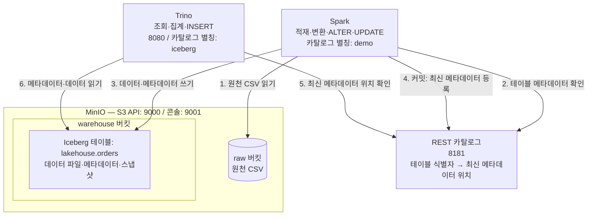

# 4주차 산출물 — 레이크하우스 아키텍처

Spark와 Trino가 REST 카탈로그를 통해 같은 Iceberg 테이블의 구조와 데이터를 공유하는 구성을 정리한다.
실습 테이블 이름은 Spark에서 `demo.lakehouse.orders`, Trino에서 `iceberg.lakehouse.orders`이다. 카탈로그 이름은 엔진 내부의 별칭이므로 서로 달라도 된다.

## 1. 아키텍처



화살표는 엔진이 접근하는 대상을 나타낸다. Iceberg는 별도 서버가 아니라 warehouse에 저장된 파일을 테이블로 관리하는 포맷이다. 카탈로그는 데이터 자체를 중계하지 않는다.

실제 ~/lakehouse/docker-compose.yml과 catalog/iceberg.properties, scripts/etl_orders.py를 확인해 구성했다. mc는 버킷 관리용 보조 컨테이너이며, Spark의 8888 포트도 Compose에 포함되어 있다. raw → Spark → MERGE 흐름은 코드로 확인했으며 이번 검토에서는 ETL 전체를 재실행하지 않았다.

## 2. 구성 요소의 역할

| 구성 요소 | 역할 | 포트 | 없으면 |
|---|---|---|---|
| MinIO | raw 원천 파일과 warehouse의 Iceberg 파일을 저장한다. | 9000: S3 API, 9001: 콘솔 | 이 구성에서 두 엔진이 공유할 파일 저장소가 없어진다. |
| Iceberg | 스키마·스냅샷·파일 목록을 관리해 파일을 일관된 테이블로 다룬다. | 별도 서비스 포트 없음 | 이 실습의 스냅샷 기반 테이블 상태와 스키마 변경 관리가 사라진다. |
| REST 카탈로그 | 테이블 이름을 최신 메타데이터에 연결하고 커밋을 관리한다. | 8181 | 이 구성에서 두 엔진이 동일한 테이블 상태를 찾는 공통 진입점이 없어진다. |
| Spark | 원천 데이터를 정제·적재하고 테이블 구조와 데이터를 변경한다. | 이 다이어그램의 외부 접속 포트 없음 | 계획한 Spark 기반 변환·적재 작업을 수행할 수 없다. |
| Trino | 공유 테이블에 SQL 조회·집계를 수행한다. | 8080 | 계획한 Trino 기반 대화형 분석 경로가 없어진다. |

## 3. 데이터 흐름

1. 원천 CSV를 raw 버킷에 저장하고 Spark가 읽는다. 실제 etl_orders.py에서 s3a://raw/orders/를 읽도록 구성되어 있다.
2. Spark가 REST 카탈로그에서 테이블 정보를 확인한다.
3. Spark가 warehouse에 Iceberg 데이터와 메타데이터를 기록한다. MERGE 기반 멱등 적재는 후속 검증 대상이다.
4. 성공한 커밋이 카탈로그에 반영되면 다른 엔진이 새 테이블 상태를 찾을 수 있다.
5. Trino가 같은 REST 카탈로그에서 메타데이터 위치를 확인한다.
6. Trino가 MinIO의 warehouse에서 해당 파일들을 읽어 결과를 반환한다.

## 4. 실행 로그로 확인한 것

| 검증 | 관찰한 결과 | 판정 |
|---|---|---|
| Spark 테이블 조회 | `demo.lakehouse.orders` 조회 성공. 10:52 로그에는 ID 1, 2, 3, 4, 5, 7, 8의 7행이 출력됐다. | 확인 |
| Spark 스키마 변경 → Trino 확인 | Spark에서 `memo STRING` 추가 후 Trino DESCRIBE에 `memo varchar`가 표시됐다. | 확인 |
| Spark 데이터 갱신 → Trino 확인 | Spark에서 ID 4의 memo를 vip로 갱신한 뒤 Trino에서 `4 / choi / vip`가 조회됐다. | 확인 |
| Spark 타입 오류 차단 | BIGINT인 order_id에 문자열 삽입 시 `CANNOT_SAFELY_CAST` 오류가 발생했다. | 쓰기 거부 확인 |
| Trino 컬럼 개수 오류 차단 | memo 추가 후 6개 컬럼에 5개 값만 넣은 INSERT가 거부됐다. | 쓰기 거부 확인 |

다음 항목은 제공된 로그만으로 완료를 주장하지 않는다.

- Trino INSERT 이후 Spark에서 동일 변경 확인.
- 두 엔진의 현재 스냅샷 ID 비교.
- 실패한 쓰기 전후 스냅샷 비교를 통한 커밋 부재 확인.
- raw CSV 읽기, 정제, MERGE 재실행의 멱등성 검증.

## 5. 재현한 핵심 SQL

Spark SQL에서 실행한 변경:

```sql
ALTER TABLE demo.lakehouse.orders ADD COLUMN memo STRING;
UPDATE demo.lakehouse.orders SET memo = 'vip' WHERE order_id = 4;
```

memo 컬럼 추가는 이미 완료했다. 같은 ALTER를 다시 실행할 필요는 없다.

Trino에서 확인한 쿼리:

```sql
DESCRIBE iceberg.lakehouse.orders;
SELECT order_id, customer, memo
FROM iceberg.lakehouse.orders
WHERE memo IS NOT NULL;
```

추가 확인용 읽기 전용 쿼리는 [trino_checks.sql](trino_checks.sql)에 정리했다. Trino 읽기 전용 쿼리는 실제 환경에서 검증했다.

## 6. 한계와 다음 단계

- Spark의 demo와 Trino의 iceberg를 혼동해 테이블 조회에 실패했다. 엔진별 카탈로그 이름을 문서와 스크립트에 명시한다.
- memo 컬럼 추가 후 기존 5개 값 INSERT가 실패했다. INSERT에는 대상 컬럼 목록을 명시해 스키마 변경의 영향을 줄인다.
- 이미 존재하는 ID 8을 다시 INSERT하려는 시도가 있었다. 재적재 시 중복을 방지하도록 키 기준 MERGE와 재실행 검증을 추가한다.
- 현재 ETL은 raw/orders/ 전체를 읽는다. 날짜별 증분 읽기를 검토한다.

## 7. 제출 전 재현 확인

제출 파일은 실제 환경에서 복사한 뒤 계정값을 환경변수로 분리한 `docker-compose.yml`, `catalog/iceberg.properties`, `scripts/` 세 파일과 이 문서의 Mermaid 다이어그램이다. 추가로 `trino_checks.sql`과 `verify_restart.sh`를 제공한다.

기존 환경에서 아래와 같이 실행한다. `verify_restart.sh`는 저장소 파일의 경로로 바꾼다.

```bash
cd ~/lakehouse
ls
ls catalog scripts
bash /path/to/data-eng-week4-lakehouse/verify_restart.sh
docker compose exec -T trino trino --execute 'SELECT count(*) FROM iceberg.lakehouse.orders;'
```

2026-10-22 실제 측정 결과:

```text
before="7","192000.0"
Trino ready; down/up elapsed=25s
after="7","192000.0"
PASS: count and sum preserved
```

- 시간은 down 시작부터 up 이후 SELECT 1 성공까지 측정했다.
- `minio-data:/data`에 데이터 파일, `rest-catalog:/home/iceberg`에 SQLite 카탈로그가 남는다. `CATALOG_URI`는 `jdbc:sqlite:file:/home/iceberg/iceberg_catalog.db`다.
- `docker compose down`에 `-v`를 붙이지 않는다. `-v`는 named volume까지 삭제한다. [Docker 공식 문서](https://docs.docker.com/reference/cli/docker/compose/down/)
- 이는 기존 볼륨을 유지한 재시작 검증이다. 새 PC에서 clone 후 up만 실행한다고 7행이 생기는 것은 아니다. 최초 버킷·테이블 생성 및 데이터 적재 절차가 추가로 필요하며, 기존 볼륨 데이터는 이 저장소에 포함하지 않는다.
- 디렉터리 이름이나 Compose 프로젝트 이름을 변경하면 다른 named volume을 사용할 수 있다. 재시작 검증은 기존 `~/lakehouse`에서 수행한다.
- 공개 제출본의 계정값은 환경변수로 분리했다. 실행 전 `.env.example`을 `.env`로 복사하고 로컬 계정을 입력한다. `.env`는 Git에 포함하지 않는다.

## 8. 제출본 검토 및 수정 내역

- `etl_orders.py`와 실패 예제 `etl_bad.py`의 MERGE 대상 컬럼을 명시해, memo 추가 후에도 기존 memo 값을 갱신으로 덮어쓰지 않도록 수정했다. 새 행의 memo는 NULL이 된다.
- 정상 ETL에서 날짜 변환 실패를 제외하고, 같은 ID·날짜의 여러 행은 customer·amount·channel 순으로 선택하도록 했다. 이 순서는 재현을 위한 규칙이며 실제 최신 이벤트를 보장하지 않는다. 실무에서는 이벤트 시각이나 수집 순번이 필요하다.
- `daily_sales`는 실제 조회에서 8월 4일 행이 빠져 있었다. 제출용 일별 집계는 orders에서 직접 계산하도록 수정했다.
- `etl_bad.py`는 중복을 제거하지 않는 의도적 실패 예제로 유지한다.
- 수정 파일은 제출 폴더에 저장했다. 실행 중인 ~/lakehouse/scripts 원본을 덮어쓰거나 ETL 쓰기를 재실행하지 않았다. MERGE의 런타임 성공과 재실행 멱등성은 추가 검증 대상이다.

## 9. 최종 검증 결과

- Spark와 Trino 집계가 모두 7행 / 192000.0으로 일치했다.
- 수정한 Trino SQL 두 파일 모두 실행 완료했으며 중복 ID는 없었다.
- 수정한 일별 집계에 2026-08-04 / 1행 / 27000.0이 포함됐다.
- Python 스크립트 두 파일의 구문 검사를 통과했다. ETL 쓰기 실행 검증과는 구분한다.

공개용 환경변수 변경 후에는 Compose 구성 해석을 검사했다. 위 25초 실측은 변경 전 기존 환경에서 얻은 결과이며, 공개용 설정으로 전체 서비스를 다시 실행한 결과는 아니다.
